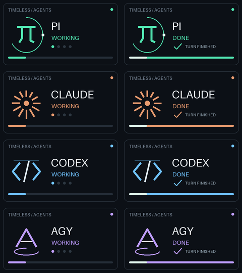

# timeless-gmk-agent-macos

Show coding agent activity on your Timeless82 or Zuoya GMK87 keyboard screen from macOS. Hooks for Pi, Claude Code, Codex, and Agy, the Antigravity CLI, play an animation when an agent starts work and when it finishes.

Each animation plays for 3 seconds, then the screen returns to its clock. Events play in order, so even a quick task shows both animations for their full duration. The hooks return immediately while a background worker updates the keyboard.



Pi has a mint orbit, Claude has an orange sun, Codex has a blue terminal cursor, and Agy has an indigo-blue floating chevron. Agent names and status labels use Bungee lettering. The eight GIFs in [animations](animations/) preview the working and finished animations.

## Supported keyboards

The scripts support keyboards with USB ID `320f:5055`, including:

- Timeless82, listed as "Timeless82 Wired"
- Zuoya GMK87

To check your keyboard, run:

```sh
hidutil list | grep -i 320f
```

## Quick start

You need macOS, Python 3, and a keyboard connected by USB cable. Create the Python environment, preload the animations, and install the agent hooks:

```sh
git clone https://github.com/fajarnuha/timeless-gmk-agent-macos.git
cd timeless-gmk-agent-macos
python3 -m venv .venv
.venv/bin/pip install -r requirements.txt
.venv/bin/python agent_hook.py display pi start
.venv/bin/python install_hooks.py
```

Restart Pi, Claude Code, and Agy after installation. In Agy, check `/hooks` for `timeless82-keyboard`. In Codex, open `/hooks` to review and trust the Timeless82 hooks. Codex skips them until you trust them. Start a coding task to see the working animation. The finished animation plays when the agent completes its turn.

The first display command uploads all 36 frames over USB. This takes about 90 seconds and replaces both custom image slots. Later events reuse those frames. Updating the animations, reconnecting the keyboard, or changing its images with another tool can require another upload. The playback timer starts after the upload, once the animation is selected.

## Agent hooks

The installer keeps other settings and hooks. Before changing a configuration file, it saves a backup beside the original. It installs hooks in these locations:

| Agent | Location | Start | Finish |
| --- | --- | --- | --- |
| Pi | `~/.pi/agent/extensions/timeless82.ts` | `agent_start` | `agent_settled` |
| Claude Code | `~/.claude/settings.json` | `UserPromptSubmit` | `Stop` |
| Codex | `~/.codex/hooks.json` | `UserPromptSubmit` | `Stop` |
| Agy / Antigravity CLI | `~/.gemini/config/hooks.json` | `PreInvocation`, once per active turn | `Stop` with `fullyIdle: true` |

Pi uses `agent_settled` instead of `agent_end` so retries, queued prompts, and compaction finish before the finished animation plays. The extension supports the Pi 1.4.0 API. Claude's `StopFailure` and Codex's `Interrupt` clear active notifications. Session shutdown also clears an active turn.

Agy uses a `timeless82-keyboard` entry in its global hooks file and keeps other named hooks. Its payload identifies the session with `conversationId`. Repeated `PreInvocation` events in the same turn do not replay the working animation. If background work is still running when `Stop` arrives, the hook waits for a later stop with `fullyIdle: true`. Errors, cancellation, and execution limits return the screen to its clock without a finished animation. The hooks use the format bundled with Agy 1.5.2.

To add Agy to an existing installation:

```sh
.venv/bin/python install_hooks.py --agents agy
.venv/bin/python agent_hook.py display agy start
```

The scripts run on this Mac. Remote or cloud agents need access to the Mac and keyboard to use them. Interrupting a turn returns the screen to its clock without a finished animation.

### Playback duration and agent selection

Set a different duration, install hooks for selected agents, or preview the installation:

```sh
.venv/bin/python install_hooks.py --duration 5
.venv/bin/python install_hooks.py --agents pi
.venv/bin/python install_hooks.py --dry-run
```

### Preview animations

Test animations directly:

```sh
.venv/bin/python agent_hook.py display pi start --duration 3
.venv/bin/python agent_hook.py display pi finish --duration 3
.venv/bin/python agent_hook.py display claude start
.venv/bin/python agent_hook.py display codex finish
.venv/bin/python agent_hook.py display agy start
.venv/bin/python agent_hook.py display agy finish
```

### Custom integrations and status

A background worker handles USB writes and the playback timer. Each session has its own ID, and an old Codex turn cannot clear a newer turn.

The hook accepts JSON on stdin with `session_id` and an optional `turn_id`, or Agy's `conversationId`. Agy stop payloads also include `fullyIdle`, `terminationReason`, and an optional `error`. Other integrations can pass `--session`:

```sh
.venv/bin/python agent_hook.py event pi start --session demo --duration 3
.venv/bin/python agent_hook.py event pi finish --session demo --duration 3
.venv/bin/python agent_hook.py status
.venv/bin/python agent_hook.py clock
```

The scripts save state and upload metadata in `.runtime/`, which Git ignores. They do not store prompts or transcripts. To use another directory, set `TIMELESS82_STATE_DIR` to the same path for every command.

A disconnected keyboard does not block an agent. The worker logs errors in `.runtime/hook.log`. After reconnecting, run `display` to upload the frames again, or `worker` to retry queued events. If another tool replaced the images, use `display pi start --force` to upload all eight animations again.

### Uninstall

Remove the hooks and return to the clock:

```sh
.venv/bin/python install_hooks.py --uninstall
.venv/bin/python agent_hook.py clock
```

The installer uses `CODEX_HOME`, `CLAUDE_CONFIG_DIR`, and `PI_CODING_AGENT_DIR` when set. Use `--agy-config-dir /path/to/config` to choose Agy's configuration directory. Use `--home /tmp/example-home` to inspect an installation in a separate home directory. Keep this checkout and its `.venv` at their installed paths, or reinstall the hooks after moving them.

Hook references: [Pi extension lifecycle](https://github.com/earendil-works/pi/blob/main/packages/coding-agent/docs/extensions.md), [Claude Code hooks](https://code.claude.com/docs/en/hooks), [Codex hooks and trust](https://learn.chatgpt.com/docs/hooks), and [Antigravity hooks](https://antigravity.google/docs/hooks).

## How it works

The installed hooks call `agent_hook.py` when an agent starts or finishes a turn. The script queues an event for the background worker. The worker selects the animation, waits for the configured duration, and restores the clock.

Each agent uses six working frames and three finished frames. All eight animations fit into the keyboard's 36-frame image memory. `kbd_screen.py` uploads them as RGB565 frames, then selects each animation by changing the frame range in the keyboard's configuration. It keeps unrelated settings and refreshes the clock during screen updates.

USB commands use the macOS HID system, with usage page `0xFF1C` and report ID `4`. The scripts and time sync utility share a lock, so only one process accesses the keyboard at a time. You don't need drivers or `sudo`.

## Troubleshooting

- If an animation does not appear, check `.runtime/hook.log` and run `.venv/bin/python agent_hook.py status`. Try a direct preview to check USB access separately from the agent hook.
- If Pi, Claude Code, or Agy does not trigger animations, restart the agent after installing the hooks. In Agy, inspect `/hooks` for `timeless82-keyboard`. In Codex, check that the Timeless82 hooks are trusted in `/hooks`.
- If the keyboard vendor interface is not found, connect the USB cable. Bluetooth and the 2.4G dongle have not been tested.
- If another tool changed the keyboard images, run `.venv/bin/python agent_hook.py display pi start --force` to upload all eight animations again.
- To clear notifications and show the clock, run `.venv/bin/python agent_hook.py clock`.

## Ad hoc time sync

`kbd_time_sync.py` copies your Mac's date and time to the keyboard. Run it to correct the clock, such as after unplugging the keyboard. Agent notifications also refresh the clock, so you can skip this step when using the hooks.

```sh
.venv/bin/python kbd_time_sync.py
```

Example output:

```text
keyboard time: 2024-09-06 08:28:44 (weekday 5)
set to:        2026-11-05 16:19:36 (weekday 4)
```

To read the keyboard settings without changing them:

```sh
.venv/bin/python kbd_time_sync.py --dump
```

The printed keyboard time is the last value written to the keyboard. It does not show the clock's current reading. The script reads the keyboard's 48-byte configuration block, updates the date and time fields at offsets 35 through 41, and writes the block back. If the screen still shows the old time, unplug the USB cable and reconnect it.

## Development

Regenerate the animation previews and run the software checks:

```sh
.venv/bin/python agent_animations.py
.venv/bin/python -m unittest discover -s tests -v
node tests/test_pi.mjs
```

The Pi smoke test needs Node.js with native TypeScript support. Python tests cover RGB565 encoding, frame ranges, USB packet construction, config preservation, overlapping events, stale turns, disconnect recovery, hook installation, and the fixed playback timer. They do not require a keyboard.

## Credits

The animations include [Bungee](https://github.com/google/fonts/tree/main/ofl/bungee) by The Bungee Project Authors under the [SIL Open Font License](assets/fonts/OFL.txt). The renderer uses the included font files, so it needs no font downloads or installed system fonts.

Jochen Eisinger reverse-engineered the protocol in [zuoya_gmk87.py](https://gist.github.com/jeisinger/b198a72c5d7d203541c6269508c9ad8c). The Go port is [rusq/kbdctl](https://github.com/rusq/kbdctl). This project adapts the protocol to macOS under the BSD-3-Clause license. See [LICENSE](LICENSE).
